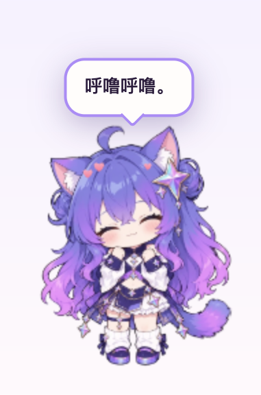
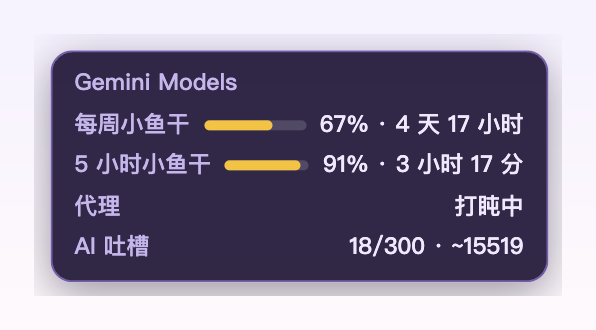
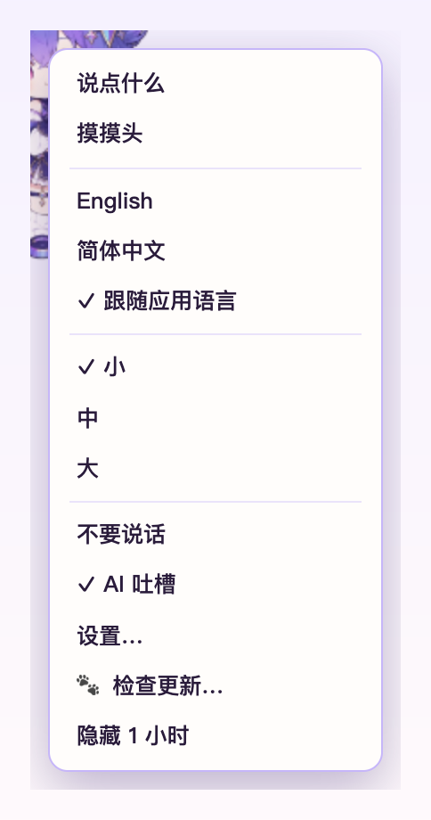
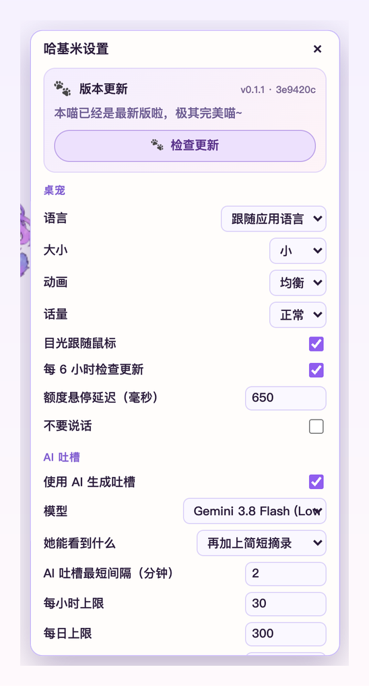

# Hagemi 桌面宿主

把她从 Antigravity 的窗口里放出来，站到桌面上。

<p align="center">
  
</p>

## 先说声谢谢

这个仓库**不含桌宠本身**。她来自 [**hagemi-pet-agy**](https://github.com/KCFindstr/hagemi-pet-agy)，
是 [**KCFindstr**](https://github.com/KCFindstr) 写的 Antigravity 插件 —— 形象、动画、行为、
台词、和语言服务打交道的全部逻辑，都是他的。这里只是给她另造了一间房子，让她能住到窗口外面去。
插件一行没改。

她身上的画来自 [**CrossPet**](https://github.com/lokicorvus/crosspet)（作者
[**lokicorvus**](https://github.com/lokicorvus) 与 CrossPet 贡献者），角色目录 `characters/gemini`，
由 hagemi-pet-agy 原样取用。

喜欢她的话，去那两个仓库点个 star，比点这里有用得多。

## 这是什么

[hagemi-pet-agy](https://github.com/KCFindstr/hagemi-pet-agy) 是一只跟着你在 Antigravity 里
干活的桌宠：你在跑任务，她跟着忙；任务完了，她跟着松一口气；额度快见底了，她跟着紧张。
但她只活在 Antigravity 的渲染进程里 —— 窗口一最小化，她就跟着不见了。

这个宿主给她单独开了一扇窗：一个透明、置顶、不抢焦点的 Electron 窗口，铺满整个屏幕。
她把这里当成「Antigravity 的应用页面」住了进来，于是你在任何 App 前面都能看见她。

<p align="center">
  
</p>

## 怎么做到的

插件的挂载方式是 CDP：读 `<profile>/DevToolsActivePort` 拿端口，去 `/json/list` 里挑一个
「应用页面」（要求是 loopback 上的 `page`，页面里有 `__APP_CONFIG__` 和 `/main.js`），
然后 `Page.createIsolatedWorld` 加 `Runtime.addBinding`，把 renderer 脚本塞进那个隔离世界。

宿主不改插件，只是把这几个条件都满足掉：

| 插件以为自己在哪 | 实际在哪 |
| --- | --- |
| `<profile>/DevToolsActivePort` 里的端口 | 宿主自己的 Electron 窗口（`HAGEMI_PROFILE_DIR` 指过来） |
| `127.0.0.1:<port>/json/list` 里的 app 页面 | 宿主自己起的一个 loopback 页面 |
| Antigravity 的语言服务 | 还是 Antigravity 的语言服务（宿主不碰） |

所以「联动」是全须全尾的：任务状态、额度、模型、AI 吐槽都来自 Antigravity 的语言服务和
brain 目录，跟窗口在哪无关。Antigravity 最小化、切到别的 App、别的程序全屏，她照样知道你在忙什么。
只有把 Antigravity 整个退掉，语言服务跟着没了，她才会变成一只只会呼吸的猫（不会崩，就是不说话）。

## 需要什么

- macOS（只在 macOS 上做过；Windows / Linux 没试过）
- 已经装好插件：`agy plugin install https://github.com/KCFindstr/hagemi-pet-agy`
- 一份 Electron 运行时（`.app`）。脚本默认用 `~/.dsh/electron/Electron.app`，
  从 [electronjs.org](https://www.electronjs.org/) 下的话解压出来就是它：

  ```sh
  ELECTRON_APP=/path/to/Electron.app ./build-app.sh
  ```

宿主自己不依赖系统里装没装 node：它用 Electron 内嵌的 node 跑插件的 sidecar。

```sh
./build-app.sh          # 生成 /Applications/Hagemi.app
open /Applications/Hagemi.app
# 或者手动起（会先杀掉旧的）：
./start.sh
```

> 如果你的 shell 里设了 `ELECTRON_RUN_AS_NODE=1`（某些 Electron 工具链会设），
> Electron 会把自己当 node 用、根本不开窗口。`start.sh` 会自动 `env -u` 掉它；
> 手敲 `open` 的话记得 `env -u ELECTRON_RUN_AS_NODE open /Applications/Hagemi.app`。

构建脚本做的事：把 Electron.app 复制成 `Hagemi.app`，改 Info.plist（名字、bundle id、
`LSUIElement` 无 Dock 图标），从插件的 `assets/logo.png` 现场生成 `icon.icns`
（仓库里不放美术文件），删掉 `ElectronAsarIntegrity`（不删的话自定义 `Resources/app` 会被拒），
把 `main.cjs` / `preload.cjs` / `package.json` 塞进 `Contents/Resources/app/`，最后 ad-hoc 签名。

**别和 App 里那只同时开。** 两只都会说话，AI 吐槽会双倍记账。装好宿主之后把窗口里那只关掉：

```sh
agy plugin disable hagemi-pet-agy
```

想换回去就 `agy plugin enable hagemi-pet-agy`，然后退出 Hagemi.app。

## 用

- **她在哪块屏**：托盘菜单里选，选完记住。默认主屏。
- **点击穿透**：只有光标落在她画出来的像素上，窗口才接管鼠标。点别的地方，点击照常落到下面的应用。
  判断方式不是估几何，而是问她自己的命中框（`elementFromPoint` 是不是 `#hagemi-pet-host`）——
  她身上的 `.hit` 本来就只有压到实心像素才会 `pointer-events:auto`。
- **右键她**：菜单（说点什么 / 摸摸头 / 语言 / 大小 / 不要说话 / AI 吐槽 / 设置… / 检查更新 / 隐藏）。

<p align="center">
  
</p>

- **设置面板**：菜单里点「设置…」，能改语言、大小、动画、话量，以及 AI 吐槽的开关和频率。
  菜单和面板打开时才向系统借键盘焦点，90 秒后自动还回去 —— 平时窗口不可聚焦，不抢你的输入。

<p align="center">
  
</p>

- **悬停她**：额度小气泡（每周 / 5 小时小鱼干、代理数、AI 吐槽用量）。
- **开机自启**：托盘勾选，写的是 `~/Library/LaunchAgents/com.hagemi.desktop.plist`，
  launchd 直接盯着宿主进程本体（不是 `open`），挂了会被拉起来。
- **找她回家**：托盘「让她重新醒来」重启插件的 sidecar，位置回到默认锚点。

## 数据放哪

`~/Library/Application Support/HagemiDesktop/`

- `data/settings.json` — 插件自己的设置（她在设置面板里的选择都在这）
- `data/host-state.json` — 宿主自己的（哪块屏）
- `logs/host.log`、`logs/sidecar.log` — 出问题先看这两个
- `profile/` — DevTools 端口和窗口缓存

## 几个不得不绕的坑

这些是写的时候真撞上、也真量过的，留个记录，省得下次再踩。

**命中框要靠「补一发鼠标移动」。** 她的 `.hit` 只在 `pointermove` 里重算。光标停着不动、
她自己走到光标底下时，页面里永远等不到那次移动，命中框还是旧的 —— 右键点不出来。
所以宿主每几百毫秒替她把一次 `pointermove` 补上再问 `elementFromPoint`。

**额度气泡还得要「真的」输入。** 上面那发 `pointermove` 是合成的，浏览器的悬停状态不认它，
`pointerenter` 不会来。得再用 `webContents.sendInputEvent` 灌一发输入管线级别的移动，
而且要先偏一格再回来（停在原地的移动会被丢掉）。顺序也不能反：
窗口还在穿透状态时灌进去的事件直接被丢弃，必须先 `setIgnoreMouseEvents(false)`。

**菜单打开后不能被自己的轮询点掉。** 她的菜单和面板只认「世界里的 pointerdown」，
宿主原本在「光标不在她身上」的每一轮都补一次 pointerdown 替用户点空白 ——
结果从菜单点开设置面板的那一瞬间，光标还停在原来的菜单项上，下一轮就把刚打开的面板关掉了。
改成只在「光标真的挪开、并且刚好从她身上离开」的那一刻收一次。

**窗口不能盖住菜单栏。** 按整块屏铺（`display.bounds`）会把菜单栏那 30px 也盖住，
macOS 于是把菜单栏的半透明材质改成采样窗口内容，屏幕最上沿紧贴菜单栏下沿就会浮出一条
明显的亮/暗分界线（实测最深掉 27 级亮度，往下 6 行衰减到 0），大屏上尤其刺眼。
改成铺 `display.workArea`：她本来也进不去菜单栏，退让 30px 没有损失。

**整机闲置久了要停手。** 上面那套「替你补一次鼠标移动」会让她的内部时钟以为你一直在动，
于是永远不打盹。所以整机十分钟没人碰之后就不再补，正好也是她该睡的时候。

**Antigravity 2.35 之后，token 得由宿主递。** 插件是靠翻 `ps` 找
`language_server --csrf_token` 拿凭据的；2.35 起 Antigravity 把 token 从命令行挪进了
子进程环境（免得在 `ps` 里被人看见），于是那条路断了，她每次轮询都报
`Language server exposes no CSRF token`，额度气泡里多一行「Antigravity 未连接」。
好在插件本来就认 `ANTIGRAVITY_LS_ADDRESS` / `ANTIGRAVITY_CSRF_TOKEN` 两个环境变量，
而新版本把凭据明文写在 `~/.gemini/antigravity/daemon/hub_<httpPort>.json` 里。
宿主读这份文件（挑 pid 还活着的那个，端口随重启递增），启动 sidecar 时递过去 ——
插件一行不用改。Antigravity 再换端口或换 token 时，宿主只重启 sidecar，不动 Antigravity 本身。

## 已知取舍

- **看不见你打字**。插件原本能感知键盘（只记时间戳，不读键值），那是在 Antigravity 的页面里。
  桌面宿主想要全局键盘得申请辅助功能权限，故意没做。
- **`screen.getCursorScreenPoint()` 在某些机器上是抖的**（同一位置会随机跳几百像素，
  用 CGEvent / NSEvent 对过，不是宿主的问题）。宿主按 45ms 轮询、只在跨越边界时动作，抖动能扛住；
  但如果你发现她偶尔该接住鼠标却没接住，挪一下鼠标就好。
- **AI 吐槽偶尔会超时**。语言服务的 `GetModelResponse` 实测单次要 26 秒上下，插件自己的预算是
  30 秒，踩线。超时一次她就安静 2 分钟（插件的失败退避是 2/5/15/30/60 分钟）。这是插件的参数，
  宿主没动。想要更稳可以在设置面板里把「AI 吐槽最短间隔」调大，或干脆关掉 AI 吐槽用本地台词。
- **只支持 macOS**。宿主用到的东西里，`setIgnoreMouseEvents` 的 forward、`LSUIElement`、
  LaunchAgent、`powerMonitor.getSystemIdleTime` 都有跨平台接口，但窗口层级、全屏应用之上的
  行为、托盘位置这些没在别的系统上验证过。

## 致谢与许可

- 桌宠本体：[hagemi-pet-agy](https://github.com/KCFindstr/hagemi-pet-agy) by
  [KCFindstr](https://github.com/KCFindstr)，代码 MIT。
- 美术：[CrossPet](https://github.com/lokicorvus/crosspet) 的 `characters/gemini`，© lokicorvus
  与 CrossPet 贡献者，[CC BY-NC-SA 4.0](https://creativecommons.org/licenses/by-nc-sa/4.0/)。
  CrossPet 的角色设定源自社区的 Gemini 拟人形象，猫娘版与 B 站的 ZipZipPipe 相关。
- 本仓库里 `docs/` 下的截图包含这份美术，因此同样按 **CC BY-NC-SA 4.0** 使用
  （非商业、相同方式共享、保留署名）。`icon.icns` 不进仓库，`build-app.sh` 现场从插件的
  `assets/logo.png` 生成，生成物同理。
- 本仓库的代码（`main.cjs`、`preload.cjs`、`build-app.sh`、`start.sh`）是 **MIT**，见 [LICENSE](LICENSE)。
- 细节和商标声明见 [NOTICE.md](NOTICE.md)。

Gemini、Google、Antigravity 是 Google LLC 的商标；Claude 是 Anthropic 的商标；
GPT、ChatGPT 是 OpenAI 的商标。本项目与它们没有隶属关系。
